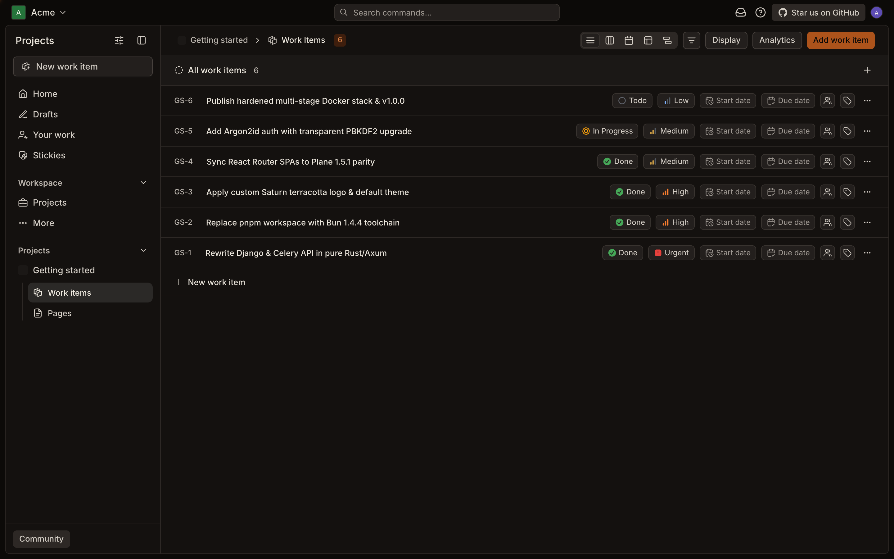
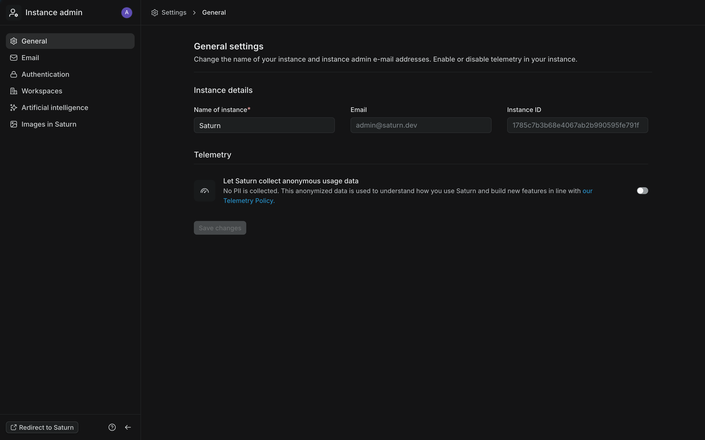

# Saturn

> **Note:** Saturn is a Rust rewrite of [Plane](https://github.com/makeplane/plane), the open source project
> management tool. Plane's Django + Celery + Redis + RabbitMQ + Node backend is replaced by one small Rust binary
> (`axum` + `sqlx`). Plane's React Router SPAs are synced to `1.5.1` (`preview @ 723bb178f9`), rebranded to
> **Saturn** with a custom geometric ringed-planet Saturn logo, built with **Bun `1.4.4`** (`bun.lock`), and served by
> the same binary as static files. Saturn keeps Plane's PostgreSQL schema, sessions, password hashes, and API shapes
> so an existing Plane database works out of the box.
> Plane is © Plane Software, Inc., licensed AGPL-3.0. Saturn is a derivative work under the same license
> (see `LICENSE`). Saturn is not affiliated with Plane Software, Inc.

## UI Screenshots

| Sign In | Workspace Home |
| --- | --- |
|  |  |

| Work Items | Instance Admin (`/god-mode`) |
| --- | --- |
|  |  |

## Size & Footprint Comparison (Original Plane vs Saturn Rewrite)

Measured directly on this repository (`../plane` read-only @ `preview` `723bb178f9` vs `saturn` macOS arm64 release build):

| Metric | Original Plane (`../plane`) | Saturn Rewrite (`saturn`) | Difference |
| --- | --- | --- | --- |
| **Backend source LOC** | `131,251` (`126,151` Python `.py` + `5,100` `live/src` `.ts`/`.tsx`) | `37,348` (`39` Rust `.rs` files) | **−71.5% LOC** (`3.51×` smaller) |
| **Backend source size** | `5.54 MiB` (`apps/api` + `live` + `proxy` excl. `.venv`/`node_modules`) | `1.44 MiB` (`src/`, plus `0.29 MiB` SQL migrations) | **−74.0% source** |
| **Backend runtime footprint** | `246.01 MiB` (`284M` disk) Python `.venv` alone + Node `live` + brokers | `19.12 MiB` (`20,047,360` bytes / `19M`) single release binary | **−92.2% vs `.venv` alone** |
| **Frontend SPA bundles** | React Router workspace (`pnpm`) | React Router workspace built with **Bun `1.4.4`**: `web` `29.51 MiB` (`33M`), `admin` `11.24 MiB` (`13M`), `space` `13.72 MiB` (`15M`) | Self-contained static SPAs served by `saturn` |
| **Runtime processes** | `6+` (Django, Celery worker, Celery beat, Node live, proxy, Redis, RabbitMQ, PostgreSQL, MinIO) | `2` (`saturn` binary + PostgreSQL) | Single app process |
| **Cold startup to `/ready`** | Seconds (Django + workers + brokers) | `58–64 ms` | Instant readiness |
| **Idle memory RSS** | Hundreds of MiB across runtimes | `8.95 MiB` (`9,168 KiB`) at boot (`14.39 MiB` after UI traffic) | Fits in `<15 MiB` |

## Why

Self-hosted Plane runs about nine containers (web, space, admin, live, api, worker, beat-worker, migrator,
proxy) plus Postgres, Redis, RabbitMQ and MinIO, and needs several GB of RAM. Saturn runs as one process with
PostgreSQL as the only dependency.

## Benchmark

<!-- BENCHMARK:START -->
Measured with [`tools/bench.sh`](tools/bench.sh) on 2026-11-11: Apple M3 (8 cores, 8 GB), macOS 27.0.1,
PostgreSQL 18.6, Redis 8.10, RabbitMQ (Homebrew). Both backends ran alone against the same PostgreSQL, each
with its own copy of the same seeded database (one admin, one workspace, one project, 2000 work items).
Load: [oha](https://github.com/hatoo/oha), 15 s, 32 concurrent connections, signed-in session cookie.
Plane ran its production settings with gunicorn (2 uvicorn workers), Celery worker and beat, and the Node live
server; Saturn ran its release build.

| Metric | Plane (Django + Celery + Redis + RabbitMQ + Node live) | Saturn (Rust) |
| --- | --- | --- |
| Backend processes | 21 (+ Redis, RabbitMQ) | 1 |
| Memory at idle (RSS) | 533 MB (+ 31 MB Redis/RabbitMQ) | 12 MB |
| Memory after load (RSS) | 379 MB | 19 MB |
| Startup to first response | 1.45 s | 0.03 s |
| Backend install size | 284 MB Python venv (plus Node for live) | 10 MB binary |
| `GET /api/users/me/` | 351 req/s, p50 90.4 ms, p99 234.9 ms | 8545 req/s, p50 3.7 ms, p99 5.3 ms |
| `GET .../issues/?per_page=100` | 17 req/s, p50 2032.8 ms, p99 3142.2 ms | 985 req/s, p50 30.3 ms, p99 79.3 ms |

Every request in both runs answered 200. Memory is a single RSS sample of the whole process tree (Plane's idle
sample came 8 s after start, while its workers were still warming up, so it reads higher than after load).
Numbers depend on the machine; rerun `tools/bench.sh <plane-checkout>` to measure your own.
<!-- BENCHMARK:END -->

## Layout

```text
src/          Rust backend (axum + sqlx), one module per Plane API area
web/          Saturn Bun workspace (bun.lock): apps/web, apps/admin (god-mode), apps/space (public boards), packages/*
docker/       Container builds and reverse proxy config (`axum/Dockerfile`, `nginx/{Dockerfile,nginx.conf}`)
migrations/   PostgreSQL schema dumped from Plane's Django migrations, plus database defaults
tools/        schema regeneration, API smoke test, benchmark
scripts/      git hook checks, branch helper, Bun frontend build
docs/         architecture, process docs, and retina UI screenshots (`docs/screenshots/`)
```

## Run

```bash
# 1. Database (plain PostgreSQL, no extensions needed). Migrations run on startup.
createdb saturn

# 2. Frontend: build the three apps once into web/apps/*/build/client
scripts/build-web.sh

# 3. First admin user, workspace and project (or open /god-mode/ and set up the instance there)
DATABASE_URL=postgres://localhost/saturn cargo run --release -- seed admin@example.com 'Change-me-2026' Acme

# 4. Serve
DATABASE_URL=postgres://localhost/saturn cargo run --release    # http://localhost:3000
```

Or run the containerized stack (`postgres` + `axum` + `nginx`):

```bash
cp .env.example .env
docker compose up -d --build
docker compose exec axum saturn seed admin@example.com 'Change-me-2026' Acme
```

| Path         | App                                  |
| ------------ | ------------------------------------ |
| `/`          | Plane web app                        |
| `/god-mode/` | Instance admin                       |
| `/spaces/`   | Published boards                     |
| `/api/`      | API (session cookie or `X-Api-Key`)  |

| Env            | Default                       | Purpose                                                    |
| -------------- | ----------------------------- | ---------------------------------------------------------- |
| `DATABASE_URL` | `postgres://localhost/saturn` | Postgres connection                                        |
| `BIND`         | `0.0.0.0:3000`                | Listen address                                             |
| `WEB_URL`      | `http://localhost:3000`       | Public origin, used for redirects and the CSRF origin check |
| `SECRET_KEY`   | dev value                     | Signs sessions. Set it in production                       |
| `WEB_DIR`      | `web/apps`                    | Built frontend apps                                        |
| `STORAGE_DIR`  | `./storage`                   | Uploaded files                                             |

An existing Plane database works too: point `DATABASE_URL` at it and set `SECRET_KEY` to Plane's value.
Passwords and sessions are compatible, so users stay signed in. Test on a copy first.

## Scope

Ported: full Plane web/admin/space backend parity — instance setup & god-mode, email/password, magic-link and OAuth sign in, SMTP outbound delivery with encrypted instance secrets, current user / profile / activity / dashboard, workspaces, projects, states, work items & activity logs, cycles (including analytics/burndown & transfer snapshots), modules, views & intake, pages & real-time Yjs collaboration + `/live/{health,convert-document,pdf-export}` endpoints, notifications & digests, webhooks & delivery, issue/analytics/activity exports (CSV, JSON, real OpenXML `.xlsx`), Unsplash & AI assistant, disk asset storage, public boards, scheduled background cleanup jobs, and the public `/api/v1` API.

Intentionally out of scope: telemetry phone-home (`push_instance_metrics`) and multi-container Redis/Celery/RabbitMQ/MinIO infrastructure. Unported `/api` or `/auth` paths answer `404`/`501`.

## Contributing

Read [`AGENTS.md`](AGENTS.md) and [`docs/`](docs/ARCHITECTURE.md) first. Short version:

- `develop` is the default branch; `master` holds released code.
- Work branches are `STN-<number>/<type>-<description>`, cut from `develop`, for example
  `STN-001/chore-repo-tooling` or `STN-014/feat-cycles-api`. Create one with
  `scripts/new-branch.sh feat-<description>`.
- Commits and PR titles are Conventional Commits in English (`feat(cycles): add cycle progress endpoint`).
  No AI co-author lines.
- Install the hooks once: `git config core.hooksPath .githooks`.

How to commit on a feature branch:

```bash
git switch develop && git pull origin develop
scripts/new-branch.sh feat-cycles-api            # -> STN-<next>/feat-cycles-api
# ... edit ...
git add src/cycles.rs tools/smoke.d/40-cycles.sh            # stage files explicitly, never `git add -A`
git commit -m "feat(cycles): add cycle list and create endpoints"
git push -u origin STN-014/feat-cycles-api       # then open a PR into develop, squash merge
```

Details: [commit](docs/github/01.GIT-COMMIT.md), [branch](docs/github/02.GIT-BRANCH.md),
[pull request and release](docs/github/03.GIT-PR-FLOW.md).

## Tests

Smoke tests need `bash`, `curl`, `jq` and `psql`. Python is only needed to regenerate the schema from Plane (`tools/plane-schema.sh`, `tools/django_defaults.py`), never to run Saturn.

```bash
cargo test                                  # unit tests (Django session and password compatibility, helpers)
BASE=http://127.0.0.1:3000 tools/smoke.sh   # API smoke test against a running, seeded server
BASE=http://127.0.0.1:3000 node tools/e2e.mjs  # Plane web app in headless Chromium, lists failing API calls
scripts/build-web.sh                        # frontend builds
```

## License

AGPL-3.0 (see `LICENSE`). Saturn is derived from Plane (AGPL-3.0, © Plane Software, Inc.): it ships Plane's
frontend apps and keeps its database schema and API.
