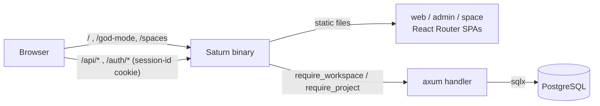

# Architecture

Short index. The details live in numbered documents under [`architectures/`](architectures/):

| Doc                                                              | Covers                                                     |
| ---------------------------------------------------------------- | ---------------------------------------------------------- |
| [01.OVERVIEW.md](architectures/01.OVERVIEW.md)                   | What Saturn replaces, request paths, auth, limits          |
| [02.STRUCTURE-PROJECT.md](architectures/02.STRUCTURE-PROJECT.md) | Folder tree, Rust modules, frontend apps, env, scripts     |
| [03.PLANE-COMPAT.md](architectures/03.PLANE-COMPAT.md)           | Schema, sessions, passwords, API shapes, porting status    |
| [04.DEPLOY.md](architectures/04.DEPLOY.md)                       | Building the release binary and frontend, production run   |

Process docs (commit, branch, PR, release) live in [`github/`](github/):

| Doc                                           | Covers                                                          |
| --------------------------------------------- | --------------------------------------------------------------- |
| [01.GIT-COMMIT.md](github/01.GIT-COMMIT.md)   | Conventional Commit format and hook checks                      |
| [02.GIT-BRANCH.md](github/02.GIT-BRANCH.md)   | `develop`, `master`, `STN-NNN/<type>-*` branches, release and hotfix |
| [03.GIT-PR-FLOW.md](github/03.GIT-PR-FLOW.md) | PR titles, review, merge, versioning, release                   |

## Rules that must not break

- **Tenant isolation in every handler.** Workspace routes call `require_workspace` / `require_project` first
  and filter every query by `workspace_id` / `project_id`.
- **Plane's role rules.** Admin 20, member 15, guest 5; restricted guests see only their own work items.
- **Values are bound, never formatted into SQL.** Only constants and whitelisted identifiers are interpolated.
- **Plane API shapes are kept.** Plane's React apps run unchanged against Saturn.

## Request paths

