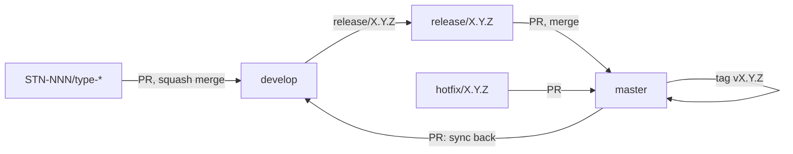

# 03. Pull request flow

How work reaches `develop` and how releases reach `master`. Branch names are in
[02.GIT-BRANCH.md](02.GIT-BRANCH.md), commit format in [01.GIT-COMMIT.md](01.GIT-COMMIT.md).



## 1. Work branch → `develop`

1. Push `STN-NNN/<type>-<description>` and open a PR into `develop`.
2. **Title:** a Conventional Commit: `feat(cycles): add cycle progress endpoint`. The `Lint PR` workflow
   fails any other title, and any head branch that is not `STN-NNN/<type>-*`, `release/*` or `hotfix/*`.
3. **Description:** fill the template: what changed, why, how it was tested. Disclosing AI tools and models
   used is welcome; AI co-author lines on commits are not.
4. CI must pass: `cargo build`, `cargo test`, the API smoke test against Postgres, and the frontend build.
5. **Merge with squash.** GitHub fills the commit subject with the PR title and `(#N)`, which keeps `develop`
   one commit per PR. Delete the branch after merging.

## 2. Release: `develop` → `master`

Versions are `MAJOR.MINOR.PATCH` in `Cargo.toml`.

| Bump    | When                                                                 |
| ------- | -------------------------------------------------------------------- |
| `major` | Breaking change to data, URLs or the API contract                    |
| `minor` | New feature or newly ported API area                                 |
| `patch` | Bug fix or small tweak                                               |

```bash
git switch develop && git pull origin develop
git switch -c release/0.2.0
# bump version in Cargo.toml, run cargo build to refresh Cargo.lock
git commit -am "chore(release): bump version to 0.2.0"
git push -u origin release/0.2.0
```

1. Open a PR from `release/X.Y.Z` into `master`, titled `chore(release): X.Y.Z`. Merge with a merge commit.
2. Tag the merge on `master`: `git tag vX.Y.Z && git push origin vX.Y.Z`.
3. Open a PR from `master` into `develop` titled `chore: sync master into develop` and merge it.

## 3. Hotfix

1. `git switch -c hotfix/X.Y.Z origin/master`, fix, bump the patch version.
2. PR into `master` titled `fix: <what>`, merge, tag `vX.Y.Z`.
3. PR `master` into `develop` to carry the fix forward.

## Local checks before opening a PR

```bash
cargo build && cargo test
BASE=http://127.0.0.1:3000 tools/smoke.sh       # with a running, seeded binary
scripts/build-web.sh                            # when touching web/
```

Do not include `.env` files, tokens or production data in commits or pull requests.
